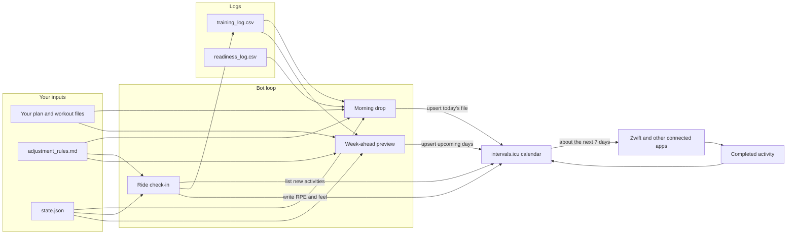

# Sync your own workouts with intervals.icu

This folder is a setup guide and a set of bot templates. It does not contain a training plan. You bring your own plan and workout files. The helper pushes those files to [intervals.icu](https://intervals.icu), which can forward planned workouts to Zwift and to other apps it is connected to.

General coaching rules live in [`generic/cycling-coach.md`](../generic/cycling-coach.md). How to turn today's plan into the file you upload is in [`adjustment_rules.md`](adjustment_rules.md).

## Disclaimer

Coaching guidance, not medical advice. Stop and see a physician for red-flag symptoms (chest pain, fainting, palpitations, unexplained collapse in performance, focal bone pain). Get a medical check before starting hard training if you are new to intensity, over about 45 with risk factors, or have any cardiac symptoms.

## What you get

| Path | What it is |
|---|---|
| `examples/test_sync_20min.zwo` | One short easy ride, power as a fraction of FTP, for a first sync test |
| `scripts/intervals_icu.py` | Upsert, list, delete, and write RPE back. Reads the API key from the environment |
| `adjustment_rules.md` | Generic rules for easing or swapping a session, with pointers into the coach file |
| `routines/` | Prompt templates for a morning drop, a ride check-in, and a week-ahead preview |
| `state.example.json` | Empty schema for your plan path, rest days, and sync cursor |
| `templates/` | Header-only CSVs for a training log and a morning readiness log |
| `gitignore.example` | Patterns so keys, logs, and local state stay off a public repo |

## Architecture



You can run the same steps by hand. A bot is optional.

## What you need

- An [intervals.icu](https://intervals.icu) account
- Your own plan, and workout files if you want them on a device or in Zwift (`.zwo` is the usual bike format)
- An intervals.icu API key in the environment variable `INTERVALS_ICU_API_KEY` (never commit it)
- Python 3.9+ if you use the helper
- For Zwift delivery: a Zwift account, and a power meter or smart trainer. Enter the same FTP in Zwift and in intervals.icu

## Setup

### 1. Create the intervals.icu account and set FTP

Sign up at [intervals.icu](https://intervals.icu). In settings, set FTP (and heart-rate zones if you use them) for the sport you are training. Zones, training load, and any workout stored as a percent of FTP all depend on that number.

Retest FTP every 6-8 weeks, or derive it from a recent best effort. Do not change it from a few easy rides. When you do change it, update every app that prescribes power (Zwift included) to the same number before the next upload.

### 2. Create an API key

In intervals.icu open Settings and find Developer settings. Create an API key and export it only in the environment of the machine or bot that runs the loop:

```bash
export INTERVALS_ICU_API_KEY="..."    # do not print, log, or commit this
```

Authentication is HTTP basic auth: username `API_KEY`, password is the key. Athlete id `0` means "the athlete who owns this key." Use `0`. Do not paste a numeric athlete id into a committed file.

The helper sends that header from Python (`urllib`) with its own User-Agent. It does not put the key on a command line. Cloudflare returns HTTP 403 to urllib's default User-Agent; a normal User-Agent gets the real API status.

If you call the API yourself with curl, pass the key on stdin so it does not show up in the process list:

```bash
curl -sS -K - <<EOF
user = "API_KEY:${INTERVALS_ICU_API_KEY}"
header = "Accept: application/json"
header = "User-Agent: fitness-coach-workout-sync/1.0"
url = "https://intervals.icu/api/v1/athlete/0/events?oldest=YYYY-MM-DD&newest=YYYY-MM-DD"
EOF
```

### 3. Connect Zwift

1. In intervals.icu open Settings, then Connections, and connect Zwift. Turn on upload of planned workouts. You can limit which activity types are downloaded and which workouts are uploaded.
2. Set FTP in Zwift to the same number as intervals.icu. Planned workouts are a percent of FTP, so a mismatch prescribes the wrong watts. Zwift does not copy the FTP across for you.
3. After an upsert, open Zwift and look under **Workouts > Custom > Intervals.icu**. Zwift also shows today's workout on the home screen. Only about the **next 7 days** of planned workouts are uploaded. Restart Zwift if a file you just uploaded does not appear.

Source: the intervals.icu forum post [Intervals.icu and Zwift integration is live](https://forum.intervals.icu/t/intervals-icu-and-zwift-integration-is-live/81764/).

On an endurance day you can ride with a Zwift RoboPacer instead of ERG and still upload a backup `.zwo`. Pick a current bot near your target W/kg from Zwift's roster and check that day's route on [Zwift Insider](https://zwiftinsider.com/robopacer-schedule/). The roster changes, so do not hard-code bot names into a committed file. Sit in the draft, stop at the planned duration, and do not use a bot for sweet spot, threshold, VO2, or a test.

### 4. Other connections

intervals.icu's own site and forum document direct connections for activities and, for some apps, planned workouts. The list changes. Check [Settings > Connections](https://intervals.icu) and the [integrations page](https://www.intervals.icu/integrations/) before you rely on a name below.

Confirmed from intervals.icu itself:

| Connection | What is documented | Where |
|---|---|---|
| Zwift | Activities in, planned workouts out for about the next 7 days | [Forum announcement](https://forum.intervals.icu/t/intervals-icu-and-zwift-integration-is-live/81764/) |
| Garmin | Activities in. The product page also says planned workouts can be uploaded to Garmin | [FAQ](https://forum.intervals.icu/t/intervals-icu-faq/123707/), [intervals.icu](https://intervals.icu/) workout-builder copy |
| Suunto | Planned workouts can be uploaded to Suunto devices | [intervals.icu](https://intervals.icu/) workout-builder copy |
| Wahoo | Activities in (the FAQ discusses Wahoo as a download source). Look in that connection's settings before assuming planned workouts upload | [FAQ](https://forum.intervals.icu/t/intervals-icu-faq/123707/) |
| Strava | Activities in. Full history import is limited unless you are a supporter. Strava is a poor primary source if a device connection already sends the same rides | [FAQ](https://forum.intervals.icu/t/intervals-icu-faq/123707/) |

Settings shows more connections than the table (watches, indoor apps, wellness). Open the current screen and the [integrations page](https://www.intervals.icu/integrations/). Do not assume each one accepts planned workouts.

If two connections import the same ride, you can get duplicates. The FAQ's advice is to keep one primary source per device and turn off the extra download (often Strava) when the device connection is already working.

This guide does not document a direct TrainingPeaks connection. If you use TrainingPeaks, check the current intervals.icu connections screen rather than assuming a sync exists.

### 5. Local files for the bot

From this folder:

```bash
cp state.example.json state.json
mkdir -p logs
cp templates/training_log.csv logs/training_log.csv
cp templates/readiness_log.csv logs/readiness_log.csv
```

Edit `state.json`: point `plan_path` at your plan, `workouts_dir` at your workout files, set `ftp_watts`, list `rest_days`, and add any `days_off`. Keep `state.json` and the logs private. Copy patterns from `gitignore.example` if you publish a fork.

`external_id_prefix` defaults to `workout`, so a day's event id looks like `workout-YYYY-MM-DD`. Re-upserting that id replaces the event instead of creating a second one. Change the prefix if you already use `workout-` for something else.

### 6. Push the example workout

This file is a 20-minute easy spin at a fraction of FTP, with one 30-second spin-up. It is a sync test, not a plan.

```bash
python scripts/intervals_icu.py upsert \
  --date YYYY-MM-DD \
  --zwo examples/test_sync_20min.zwo
```

Then:

1. On the intervals.icu calendar, confirm the event for that date and that it carries your `.zwo`.
2. In Zwift, open **Workouts > Custom > Intervals.icu** (restart Zwift if needed). The date has to fall inside the next week of uploads.
3. Delete it when you are done: `python scripts/intervals_icu.py delete-by-date --date YYYY-MM-DD`.

The upsert posts one workout to `POST /api/v1/athlete/0/events/bulk?upsert=true` with `category: WORKOUT`, `type: VirtualRide`, `indoor: true`, `filename`, `file_contents` (the raw `.zwo` XML), and `external_id`. Notes: [uploading planned workouts](https://forum.intervals.icu/t/uploading-planned-workouts-to-intervals-icu/63624) and [API access](https://forum.intervals.icu/t/api-access-to-intervals-icu/609). For an outdoor ride, add `--outdoor` or pass `--type Ride`.

### 7. Point a bot at your plan

The prompts in `routines/` are empty of any particular week structure. Replace every `{{PLACEHOLDER}}` with your paths, your rest days, and your timezone. Schedule them however you train (one cron expression per job; two check-in times belong in one expression, for example `30 10,17 * * *`, not two crons joined by a semicolon).

| When you want it | What it does | Template |
|---|---|---|
| Before the usual session | Choose today's file from your plan, apply the rules, upsert or delete | [`routines/morning_workout_drop.md`](routines/morning_workout_drop.md) |
| After the usual session | Log new activities, grade the ride, write RPE back | [`routines/ride_check_in.md`](routines/ride_check_in.md) |
| Before the next block of days the app will sync | Preview upcoming sessions and upsert them | [`routines/week_ahead_preview.md`](routines/week_ahead_preview.md) |

Use a recovery week every 3-4 weeks (a 3:1 or 2:1 pattern): about 40-50% less volume, and keep a little intensity. The bot should follow your plan's recovery weeks, not a calendar baked into this repo.

## Helper script

`scripts/intervals_icu.py` reads `INTERVALS_ICU_API_KEY` and never prints it.

```bash
python scripts/intervals_icu.py upsert --date YYYY-MM-DD --zwo examples/test_sync_20min.zwo
python scripts/intervals_icu.py list-activities --oldest YYYY-MM-DD --newest YYYY-MM-DD
python scripts/intervals_icu.py list-events --oldest YYYY-MM-DD --newest YYYY-MM-DD
python scripts/intervals_icu.py set-rpe --activity-id ACTIVITY_ID --rpe 5 --feel 2
python scripts/intervals_icu.py delete-by-date --date YYYY-MM-DD
python scripts/intervals_icu.py delete-event --event-id EVENT_ID
```

`feel` on intervals.icu is 1-5 with **1 = strong and 5 = weak**, the opposite of a readiness scale where 5 is best. `icu_rpe` has to be a whole number.

## Fallback: a local Zwift folder

If the API is down, copy today's `.zwo` into:

```
.../Documents/Zwift/Workouts/<ZWIFT_USER_ID>/
```

That numeric folder name is the Zwift user id on that computer. Do not commit it. The copy only works when that computer is on, so treat it as a backup.

## Troubleshooting

| Symptom | What to try |
|---|---|
| HTTP 403 from Python | Cloudflare blocks urllib's default User-Agent (error 1010). Use this helper, which sets a User-Agent. Do not pass the key with curl `-u`. |
| HTTP 401 | The key was rejected. Create a new one under Developer settings and re-export the env var. Do not log the key. |
| Workout missing in Zwift | Zwift connected, planned-workout upload on, the date is inside the next week, the event exists on the intervals.icu calendar, then restart Zwift. |
| Wrong watts | FTP in Zwift and intervals.icu do not match. Align them. Do not change FTP off a few easy rides. |
| Duplicate calendar events | Upsert again with the same `external_id` (`workout-YYYY-MM-DD` unless you changed the prefix). |
| Duplicate activities | Two connections are importing the same ride. Keep one primary source. See the [FAQ](https://forum.intervals.icu/t/intervals-icu-faq/123707/). |
| `icu_rpe` rejected | Send a whole number. Store a half (4.5) in the CSV if you want, and write 4 or 5 to the API. |
| `feel` looks backwards | intervals.icu: 1 = strong, 5 = weak. |
| Workout not on a watch or head unit | That connection may import activities but not accept planned workouts. Check its settings. Garmin and Suunto are documented for workout upload; do not assume every connection is. |
| Two cron times failed to register | Put both hours in one expression (`30 10,17 * * *`). |

## Privacy

A public copy of this folder should contain the example state, the header-only CSVs, the rules, the script, the prompts, and the one example `.zwo`. Leave out API keys, athlete ids, Zwift folder ids, real `state.json` values, and completed log rows.
