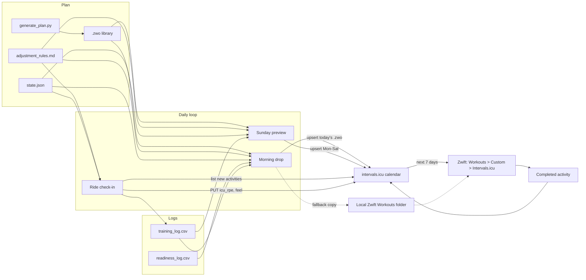

# Integrating a 12-week cycling plan with Zwift

This folder is a practical, reproducible workflow for running a power-based 12-week indoor cycling plan on [Zwift](https://www.zwift.com), with day-to-day adjustments and an [intervals.icu](https://intervals.icu) sync so planned workouts show up in Zwift automatically.

It is an implementation of the check-in loop in [`tracker/TRACKER.md`](../tracker/TRACKER.md) and the coaching rules in [`generic/cycling-coach.md`](../generic/cycling-coach.md). You can run it with any capable AI assistant, or follow the same steps by hand.

## Disclaimer

Coaching guidance, not medical advice. Stop and see a physician for red-flag symptoms (chest pain, fainting, palpitations, unexplained collapse in performance, focal bone pain). Get a medical check before starting hard training if you are new to intensity, over about 45 with risk factors, or have any cardiac symptoms.

## What you get

| Path | What it is |
|---|---|
| `generate_plan.py` | Writes the 12-week `.zwo` library (power as a fraction of FTP) |
| `workouts/` | Pre-generated copy of that library, ready to upload |
| `adjustment_rules.md` | Rider-agnostic rules for easing, swapping, or holding sessions |
| `state.example.json` | Schema for plan start, FTP, slip days, days off, RoboPacer picks |
| `templates/` | Header-only CSVs for the training log and morning readiness log |
| `routines/` | Reusable prompt templates for the three scheduled jobs |
| `scripts/intervals_icu.py` | Helper for upsert, list, delete, and write-back of RPE |
| `gitignore.example` | Patterns to keep keys, logs, and local state out of a public repo |

## Architecture



Endurance days can be ridden with Zwift RoboPacer bots (a backup Z2 `.zwo` is still pushed). Quality days stay on ERG using the structured file. intervals.icu is the primary delivery path because a local folder drop only works when that computer is online.

## What you need

- A Zwift account and a power meter or a smart trainer that reports power
- An [intervals.icu](https://intervals.icu) account, connected to Zwift, with planned-workout upload turned on
- An intervals.icu API key stored as the environment variable `INTERVALS_ICU_API_KEY` (never committed)
- Python 3.9+ and `curl`, if you use the helper script
- Your current FTP, entered **identically** in Zwift and in intervals.icu

## Setup

### 1. Generate the workout library

From this folder:

```bash
python generate_plan.py --out ./workouts --ftp 250
```

`--ftp` only prints a watt-target table. The `.zwo` files themselves store power as a fraction of FTP, so the same library works for any rider. Optional flags: `--author`, `--tag`, `--zip PATH`.

### 2. Create a working state file and logs

```bash
cp state.example.json state.json   # then edit plan_start and ftp_watts
mkdir -p logs
cp templates/training_log.csv logs/training_log.csv
cp templates/readiness_log.csv logs/readiness_log.csv
```

Set `plan_start` to the Monday of week 1. Add any planned days off (travel, holidays) under `days_off` so they are not treated as missed sessions. Keep `state.json` and the logs private; see `gitignore.example`.

Plan week is:

```
floor((today - plan_start - slip_days) / 7) + 1
```

`slip_days` starts at 0. Add 7 only when the missed-session rule says to repeat a week.

### 3. Create an intervals.icu API key

In intervals.icu, open Settings and find Developer Settings. Create an API key and export it in the environment of whatever runs the daily loop:

```bash
export INTERVALS_ICU_API_KEY="..."    # do not print, log, or commit this
```

Authentication is HTTP basic auth with the username `API_KEY` and the key as the password:

```bash
curl -sS -u API_KEY:$INTERVALS_ICU_API_KEY \
  "https://intervals.icu/api/v1/athlete/0/activities?oldest=2026-11-01&newest=2026-11-15"
```

Athlete id `0` means "the athlete who owns this key." Some Python HTTP clients, including `urllib`, have been observed to get HTTP 403 with the same credentials; the helper script uses `curl` for that reason.

### 4. Connect Zwift to intervals.icu and match FTP

1. In intervals.icu settings, connect your Zwift account and enable upload of planned workouts to Zwift.
2. Set FTP in intervals.icu to the same number Zwift uses. If they differ, every interval will be prescribed at the wrong watts.
3. After the first upsert, open Zwift and look under **Workouts > Custom > Intervals.icu**. Only the **next 7 days** of planned workouts sync. Restart Zwift if a newly uploaded file does not appear.

### 5. Push a first workout (smoke test)

```bash
python scripts/intervals_icu.py upsert \
  --date YYYY-MM-DD \
  --zwo workouts/Mon_Z2_60.zwo
```

The event is stored with `external_id` `cp12-YYYY-MM-DD` (the prefix is configurable). Re-running the same command replaces that event instead of creating a duplicate. Confirm it appears on the intervals.icu calendar and, after a refresh, in Zwift.

### 6. Start the loop

Use the three prompt templates in `routines/` with an AI assistant on a schedule, or run the same steps yourself:

| When | What | Template |
|---|---|---|
| Daily, before the usual ride (about 6:00 AM in the original workflow) | Choose today's session, apply rules, upsert or delete the event, ask the readiness questions | [`routines/morning_workout_drop.md`](routines/morning_workout_drop.md) |
| After typical ride times (about 10:30 AM and 5:30 PM originally) | Log new activities, grade the ride, ask for RPE, write RPE back | [`routines/ride_check_in.md`](routines/ride_check_in.md) |
| Sunday | Preview next week and upsert Mon-Sat so Zwift has the next 7 days | [`routines/sunday_week_preview.md`](routines/sunday_week_preview.md) |

A schedule needs one valid cron expression per job. If you want two check-in times, use a single expression with two hours (for example `30 10,17 * * *`), not two crons joined by a semicolon.

## File and state layout

```
zwift/
  generate_plan.py
  workouts/*.zwo              # library; safe to regenerate
  adjustment_rules.md
  state.example.json          # commit this
  state.json                  # local working copy; do not commit
  templates/*.csv             # headers only
  logs/*.csv                  # local data; do not commit
  routines/*.md
  scripts/intervals_icu.py
```

`state.example.json` is commented by key name in the file itself. The fields you will actually edit:

| Field | Role |
|---|---|
| `plan_start` | Monday of week 1 |
| `ftp_watts` | Current FTP; update only after a test |
| `slip_days` | Days the whole plan has been shifted |
| `days_off` | Map of `YYYY-MM-DD` to a short reason; not missed, not made up |
| `week_overrides` | Optional per-week day-to-file map (holidays, a moved FTP test) |
| `adjustments` | Lasting or next-session changes, with the reason |
| `pending_missed` | Key sessions waiting for a suitable make-up day |
| `intervals_icu.last_seen_activity_id` | Cursor so the check-in only sees new rides |
| `robopacer` | Bot roster (W/kg), default picks, and draft rules |
| `zwift_workouts_dir` | Optional fallback folder on a computer that runs Zwift |

Do not put API keys, athlete ids, machine ids, or the numeric Zwift user-folder id in a committed file. Use placeholders in examples, and keep real values in the untracked `state.json` or the environment.

## The 12-week plan

Default week shape:

| Day | Session |
|---|---|
| Mon | 60 min Z2 (keep it light if the previous day was lower-body strength) |
| Tue | 75 min Z2 |
| Wed | Quality session 1 |
| Thu | Off-bike strength (no Zwift ride) |
| Fri | Quality session 2 |
| Sat | Long ride |
| Sun | Rest (an optional 40 min very-easy spin is in the library) |

Week-by-week quality work:

| Week | Phase | Wed | Fri | Sat |
|---|---|---|---|---|
| 1 | Base | Sweet spot 3×10 | Z2 + 6×30s spin-ups | 2h30 Z2 |
| 2 | Base | Sweet spot 3×12 | Z2 + 6×30s spin-ups | 2h45 Z2 |
| 3 | Base | Sweet spot 3×15 | Z2 + 8×30s spin-ups | 3h00 Z2 |
| 4 | Deload | Sweet spot 2×10 | Easy Z2 60 | 2h00 Z2 |
| 5 | Build | Threshold 2×15 | VO2 5×3 | 2h45 + 2×15 tempo |
| 6 | Build | Threshold 3×12 | VO2 6×3 | 2h45 + 2×20 tempo |
| 7 | Build | Threshold 2×20 | VO2 5×4 | 3h00 + 2×20 tempo |
| 8 | Build | Threshold 3×15 | VO2 6×4 | 3h00 + 3×15 tempo |
| 9 | Deload / travel | Easy 45-60 min rides, or days off | | |
| 10 | Build | Threshold 2×20 | VO2 5×4 | 3h00 + 2×20 tempo |
| 11 | Build | Threshold 3×15 | VO2 6×4 | 3h15 + 3×15 tempo |
| 12 | Test / deload | Openers 2×8 | 20-min FTP test | Easy Z2 2h00 |

You can move week 12's openers and test with `week_overrides` (for example, openers two days before the test, very easy or rest the day before). Do not adjust the test itself off of how earlier sessions felt.

Target fractions used in the files (print watts with `--ftp`):

| Type | Fraction of FTP |
|---|---|
| Very easy / recovery between intervals | 0.55 |
| Monday easy Z2 | 0.62 |
| Default Z2 | 0.65 |
| Long-ride Z2 | 0.68 |
| Tempo | 0.83 |
| Sweet spot | 0.91 |
| Threshold | 1.00 |
| VO2 | 1.15 |

## The daily loop

### Morning drop

Resolve today's file from the plan week, the weekday template, `week_overrides`, and `days_off`. Apply [`adjustment_rules.md`](adjustment_rules.md) (readiness flags, hard/easy days, missed sessions, illness, deloads, ceilings, weekly checks). Upsert the adjusted `.zwo`, or delete the event on a rest day.

On Z2 days, name a RoboPacer bot from the roster in `state.json` and look up the day's route on [Zwift Insider's RoboPacer schedule](https://zwiftinsider.com/robopacer-schedule/). Sit in the draft; real power typically runs about 10-20% under the bot. Leave when the planned duration is done, and drop to the next-slower bot if HR drifts or RPE goes above 4. Never use a bot on a quality day. Long rides with tempo blocks stay on the structured `.zwo` because those blocks need ERG.

Every morning message ends with a 30-second readiness check-in: sleep hours; sleep quality, legs, energy, and stress on a 1-5 scale; whether the athlete woke at night and why; resting HR if they have it. Log the reply. Two or more flags on a quality day means swap that session to Z2 or rest and re-upsert.

### Ride check-in

List activities newer than `last_seen_activity_id`. Log duration, average and normalized power, TSS, HR, kJ, and decoupling. Grade the ride A-D with one reason, then ask for RPE, legs, pain or illness, why it was hard if it was, and carbs per hour on rides over 90 minutes. Write `icu_rpe` (integers only) and optional `feel` back to the activity. intervals.icu `feel` is 1-5 with **1 = strong and 5 = weak**, the opposite of the readiness "legs/energy" scale.

### Sunday preview

Apply the weekly checks, then upsert the coming Mon-Sat events (and delete rest days) so Zwift has the next 7 days. The message lists watt targets, RoboPacer picks, the Thursday strength session, fueling on long days, and a short prep note for the hardest session.

## Helper script

`scripts/intervals_icu.py` reads `INTERVALS_ICU_API_KEY` and never prints it.

```bash
python scripts/intervals_icu.py upsert --date 2026-11-16 --zwo workouts/Mon_Z2_60.zwo
python scripts/intervals_icu.py list-activities --oldest 2026-11-01 --newest 2026-11-16
python scripts/intervals_icu.py list-events --oldest 2026-11-16 --newest 2026-11-22
python scripts/intervals_icu.py set-rpe --activity-id 123456 --rpe 5 --feel 2
python scripts/intervals_icu.py delete-by-date --date 2026-11-16
python scripts/intervals_icu.py delete-event --event-id 123456
```

Upsert sends a one-element array to `POST /api/v1/athlete/0/events/bulk?upsert=true` with `category: WORKOUT`, `type: VirtualRide`, `indoor: true`, `start_date_local`, `filename`, `file_contents` (the raw `.zwo` XML), and `external_id`. Official API notes: [uploading planned workouts](https://forum.intervals.icu/t/uploading-planned-workouts-to-intervals-icu/63624) and [API access](https://forum.intervals.icu/t/api-access-to-intervals-icu/609).

## Fallback: local Zwift folder

If the API is unavailable, copy today's `.zwo` into:

```
.../Documents/Zwift/Workouts/<ZWIFT_USER_ID>/
```

The numeric folder name is the Zwift user id for that install. This path only works when that computer is reachable, and it is easy to drop a file that Zwift never sees. Treat it as a backup, not the primary delivery path.

## Troubleshooting

| Symptom | What to try |
|---|---|
| HTTP 403 from a Python client | Use `curl -u API_KEY:$KEY`, or this repo's helper. Confirm the key is the intervals.icu API key, not a bearer token from another service. |
| HTTP 401 / still 403 with curl | Regenerate the key in Developer Settings and re-export the env var. Do not log the key while debugging. |
| Workout does not appear in Zwift | Confirm intervals.icu is connected to Zwift with planned-workout upload on; only the next 7 days sync; restart Zwift; check the event exists on the intervals.icu calendar. |
| Workout appears at the wrong watts | FTP in Zwift and intervals.icu do not match. Align them. Do not change FTP based on a few easy rides. |
| Duplicate calendar events | Re-upsert with the same `external_id` (`cp12-YYYY-MM-DD`). Do not POST a new event without that id. |
| `icu_rpe` rejected | Send a whole number only. If the athlete said 4.5, store 4.5 in the CSV and write 4 or 5 to the API. |
| `feel` looks backwards | intervals.icu: 1 = strong, 5 = weak. Readiness legs/energy: 5 = best. Map before writing. |
| Check-in ran during the ride | Skip in-progress activities; the next run will log them. |
| Local folder copy did nothing | The Zwift computer was offline, or the file landed outside `Documents/Zwift/Workouts/<ZWIFT_USER_ID>/`. Prefer intervals.icu. |
| Two cron times failed to register | Combine hours in one expression (`30 10,17 * * *`), don't join two crons with a semicolon. |
| Quality day after a rough night | Apply the readiness flags. Two or more flags: swap to Z2 or rest and re-upsert before they ride. |

## Privacy

A public fork of this repo should contain only the example state, header-only CSVs, rules, scripts, and workout library. Leave out API keys, athlete ids, machine ids, Zwift folder ids, real `state.json` values, and completed log rows. Those belong on the machine (or private store) that runs the loop.
